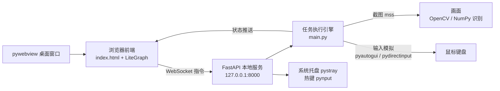

# OpenTask

<p align="center">
  <b>基于节点图的 Windows 桌面自动化工具</b><br>
  用可视化连线编排「截图识别 → 判断 → 鼠标键盘操作 → 循环控制」，无需编写代码。
</p>

<p align="center">
  
  
  
</p>

---

## 目录

- [功能特性](#-功能特性)
- [内置节点](#-内置节点)
- [快速开始](#-快速开始)
- [项目结构](#-项目结构)
- [工作原理](#-工作原理)
- [工程文件](#-工程文件)
- [环境变量](#-环境变量)
- [常见问题](#-常见问题)
- [免责声明](#-免责声明)
- [许可证](#-许可证)

---

## ✨ 功能特性

- **可视化节点编排**：基于 LiteGraph 的画布编辑器，拖节点、连线即可定义任务流程。
- **多种画面识别**：模板匹配（归一化相关系数，抗亮度变化）、多点找色、智能置中（目标追踪）。
- **硬件级输入模拟**：鼠标点击/移动、键盘按下/抬起/组合键，兼容部分以管理员权限运行的游戏窗口。
- **宏录制**：录制真实鼠标键盘操作并回放为动作宏节点。
- **循环与计数**：支持计数分支、锚点跳转与返回，实现重复任务。
- **热键控制**：可为开始节点和结束节点绑定全局热键，随时启动/停止。
- **后台托盘运行**：关闭窗口后转入系统托盘，右键菜单可退出、设置开机自启、打开程序目录。
- **未保存提醒**：关闭软件、新建/打开/切换工程时，若有未保存修改，弹出「保存 / 不保存 / 取消」三按钮确认。
- **开箱即用**：提供免安装打包版，也可直接源码运行。

> 仅支持 **Windows** 平台。

---

## 🧩 内置节点

| 分类 | 节点 | 说明 |
|---|---|---|
| 流程控制 | `开始` / `结束` | 定义流程入口与出口，可绑定启动/停止热键 |
| 流程控制 | `返回至（锚点）` / `返回（跳跃）` | 实现循环与跳转 |
| 画面识别 | `图像` | 加载截图模板（支持从剪贴板/文件选取） |
| 画面识别 | `图像识别` | 模板匹配，输出「识别到 / 未识别 / 位置」，支持限定识别范围与置信度 |
| 画面识别 | `多点找色` | 以主锚点颜色 + 多个偏移点颜色校验，输出「找到 / 未找到 / 坐标」 |
| 画面识别 | `智能置中` | 依据目标图像 deviation 自动移动准星，支持视角/光标模式与灵敏度自校准 |
| 数据 | `坐标` / `向量计算` / `当前指针位置` | 生成与变换坐标、获取鼠标当前位置 |
| 鼠标 | `鼠标按下` / `鼠标抬起` / `鼠标移动` / `鼠标点击` | 支持前后延时、持续时间、按键选择 |
| 键盘 | `按键` / `键盘按下` / `键盘抬起` | 支持组合键与连续按键 |
| 辅助 | `动作宏` | 录制并回放一段真实操作 |
| 辅助 | `延时` | 固定或随机延时 |
| 辅助 | `计数` | 按次数分支，节点上实时显示当前计数 |

---

## 🚀 快速开始

### 方式一：打包版（推荐，无需 Python）

1. 下载发布包，解压后进入 `OpenTask 0.1.0` 文件夹。
2. 双击 `OpenTask.exe`。首次启动会请求管理员权限——这是为了能录制以管理员权限运行的窗口输入；如不需要，可拒绝并降级为普通权限运行。
3. 关闭窗口后程序会转入系统托盘；**右键托盘图标 → 退出**才会真正关闭。

> 运行环境要求：Windows 10/11，且系统已安装 **Edge WebView2 Runtime**（较新的 Windows 通常自带）。

### 方式二：源码运行

```bash
# 安装依赖（Python 3.8+）
pip install -r requirements.txt

# 启动
python main.py
```

Windows 用户也可直接双击 `run.bat`：脚本会自动检测 Python、首次运行时安装依赖并启动程序。

### 自行打包

```bash
build_exe.bat
```

脚本会自动安装 PyInstaller，并以 onedir 模式生成 `dist\OpenTask` 目录，将其内容复制到发布目录即可。

---

## 📁 项目结构

```text
OpenTask Code/
├── main.py                 # 后端：FastAPI 服务、WebSocket 通信、任务执行引擎、托盘与系统交互
├── requirements.txt        # Python 依赖
├── run.bat                 # 源码一键启动脚本
├── build_exe.bat           # PyInstaller 打包脚本
├── pyrightconfig.json      # 类型检查配置
├── probe_*.py              # 开发期诊断脚本（截图/比对/输入/窗口探测）
└── static/
    ├── index.html          # 前端：节点定义、画布交互、WebSocket 客户端
    ├── litegraph.js/css    # 节点编辑器库（本地引用，无外网依赖）
    └── icon.ico/png        # 程序图标
```

---

## 🏗️ 工作原理



- **前端**负责编排与展示，节点图以 JSON 保存。
- **后端**在本地启动 HTTP/WebSocket 服务，前端通过 WebSocket 下发 `start` / `stop` / 保存 / 加载等指令，后端实时回推执行状态、日志、计数与识别结果。
- 识别使用 `mss` 截图 + OpenCV 模板匹配 / 颜色掩膜；输入模拟使用 `pyautogui`、`pydirectinput`；热键与输入录制使用 `pynput`。

---

## 💾 工程文件

- 工程以 `.otk` 文件保存（本质是包含 `nodes` / `links` 的 JSON）。
- 支持「保存 / 另存为 / 加载 / 最近项目」。
- 修改后关闭软件或切换工程，会弹出三按钮确认：**保存**（写入成功后继续）、**不保存**（放弃修改继续）、**取消**（中止当前操作）。
- 最近项目列表保存在当前用户目录；若以提权账户运行，会写入该提权账户的用户目录。

---

## ⚙️ 环境变量

| 变量 | 作用 |
|---|---|
| `OPEN_TASK_NO_ELEVATE=1` | 跳过 UAC 提权，以普通权限启动（无法录制高权限窗口的输入） |
| `OPEN_TASK_NO_SINGLE_INSTANCE=1` | 允许多开（默认启用单实例保护，重复启动会激活已有窗口） |

程序默认占用 `127.0.0.1:8000`，若被占用会依次尝试 8001–8019。

---

## ❓ 常见问题

**Q：双击 exe 后没有窗口？**
先确认已安装 WebView2 Runtime；若是权限问题，可设置环境变量 `OPEN_TASK_NO_ELEVATE=1` 后重试，以区分提权失败与其他故障。

**Q：录不到某个游戏的鼠标键盘操作？**
该游戏可能以管理员权限运行。请以管理员身份启动 OpenTask（允许 UAC 提权）后再录制。

**Q：关闭窗口后进程还在？**
这是设计行为——窗口关闭后程序转入后台托盘。请右键托盘图标选择「退出」，进程与托盘图标会一并清理。

**Q：纯色模板识别不到？**
归一化相关系数算法要求模板有一定纹理变化，纯色模板方差为零会失效。建议使用带细节的截图区域。

**Q：旧版工程的识别阈值失效？**
识别算法已从归一化互相关升级为相关系数匹配，旧工程中按旧算法标定的高置信度阈值可能需要适当下调。

---

## ⚠️ 免责声明

本项目仅供学习与技术交流，请遵守所在平台/游戏的用户协议与当地法律法规。使用者因自动化操作产生的任何账号风险或损失，由使用者自行承担。

---

## 📄 许可证

上传 GitHub 前请根据实际情况补充 LICENSE 文件（如 MIT / GPL-3.0）。在此之前，本项目代码版权归作者所有。
