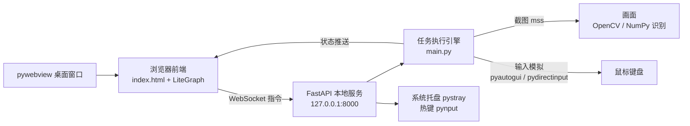
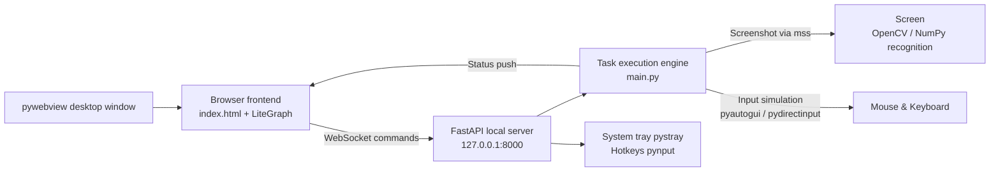

<a id="top"></a>

# OpenTask

<p align="center">
  
  
  
</p>

<p align="center">
  <a href="#chinese">中文</a> · <a href="#english">English</a>
</p>

---

<a id="chinese"></a>

# OpenTask 中文文档

<p align="center">
  <b>基于节点图的 Windows 桌面自动化工具</b><br>
  用可视化连线编排「截图识别 → 判断 → 鼠标键盘操作 → 循环控制」，无需编写代码。
</p>


## 💬 联系作者<br>
由 舟午YueMoon 开发。<br>
如果你有任何建议、遇到了 BUG，或者单纯想催更，欢迎在B站/Youtube相关视频的评论区告诉我！<br>
博客：http://yuemoon.vip/<br>
GitHub：@YueMoon99<br>
B站：UID223633562<br>
YouTube：@YueMoon99<br>

## 目录

- [功能特性](#cn-features)
- [内置节点](#cn-nodes)
- [快速开始](#cn-quickstart)
- [项目结构](#cn-structure)
- [工作原理](#cn-architecture)
- [工程文件](#cn-project)
- [环境变量](#cn-env)
- [常见问题](#cn-faq)
- [免责声明](#cn-disclaimer)
- [许可证](#cn-license)

---

<a id="cn-features"></a>

## ✨ 功能特性

- **可视化节点编排**：基于 LiteGraph 的画布编辑器，拖节点、连线即可定义任务流程。
- **多种画面识别**：模板匹配（归一化相关系数，抗亮度变化）、多点找色、智能置中（目标追踪）。
- **硬件级输入模拟**：鼠标点击/移动、键盘按下/抬起/组合键，兼容部分以管理员权限运行的游戏窗口。
- **宏录制**：录制真实鼠标键盘操作并回放为动作宏节点。
- **循环与计数**：支持计数分支、锚点跳转与返回，实现重复任务。
- **热键控制**：可为开始节点和结束节点绑定全局热键，随时启动/停止。
- **后台托盘运行**：关闭窗口后转入系统托盘，右键菜单可退出、设置开机自启、打开程序目录。
- **未保存提醒**：关闭软件、新建/打开/切换工程时，若有未保存修改，弹出「保存 / 不保存 / 取消」三按钮确认。
- **开箱即用**：提供免安装打包版，也可直接源码运行。

> 仅支持 **Windows** 平台。

---

<a id="cn-nodes"></a>

## 🧩 内置节点

| 分类 | 节点 | 说明 |
|---|---|---|
| 流程控制 | `开始` / `结束` | 定义流程入口与出口，可绑定启动/停止热键 |
| 流程控制 | `返回至（锚点）` / `返回（跳跃）` | 实现循环与跳转 |
| 画面识别 | `图像` | 加载截图模板（支持从剪贴板/文件选取） |
| 画面识别 | `图像识别` | 模板匹配，输出「识别到 / 未识别 / 位置」，支持限定识别范围与置信度 |
| 画面识别 | `多点找色` | 以主锚点颜色 + 多个偏移点颜色校验，输出「找到 / 未找到 / 坐标」 |
| 画面识别 | `智能置中` | 依据目标图像偏差自动移动准星，支持视角/光标模式与灵敏度自校准 |
| 数据 | `坐标` / `向量计算` / `当前指针位置` | 生成与变换坐标、获取鼠标当前位置 |
| 鼠标 | `鼠标按下` / `鼠标抬起` / `鼠标移动` / `鼠标点击` | 支持前后延时、持续时间、按键选择 |
| 键盘 | `按键` / `键盘按下` / `键盘抬起` | 支持组合键与连续按键 |
| 辅助 | `动作宏` | 录制并回放一段真实操作 |
| 辅助 | `延时` | 固定或随机延时 |
| 辅助 | `计数` | 按次数分支，节点上实时显示当前计数 |

---

<a id="cn-quickstart"></a>

## 🚀 快速开始

### 方式一：打包版（推荐，无需 Python）

1. 下载发布包，解压后进入 `OpenTask 0.1.0` 文件夹。
2. 双击 `OpenTask.exe`。首次启动会请求管理员权限——这是为了能录制以管理员权限运行的窗口输入；如不需要，可拒绝并降级为普通权限运行。
3. 关闭窗口后程序会转入系统托盘；**右键托盘图标 → 退出**才会真正关闭。

> 运行环境要求：Windows 10/11，且系统已安装 **Edge WebView2 Runtime**（较新的 Windows 通常自带）。

### 方式二：源码运行

```bash
# 安装依赖（Python 3.8+）
pip install -r requirements.txt

# 启动
python main.py
```

Windows 用户也可直接双击 `run.bat`：脚本会自动检测 Python、首次运行时安装依赖并启动程序。

### 自行打包

```bash
build_exe.bat
```

脚本会自动安装 PyInstaller，并以 onedir 模式生成 `dist\OpenTask` 目录，将其内容复制到发布目录即可。

---

<a id="cn-structure"></a>

## 📁 项目结构

```text
OpenTask Code/
├── main.py                 # 后端：FastAPI 服务、WebSocket 通信、任务执行引擎、托盘与系统交互
├── requirements.txt        # Python 依赖
├── run.bat                 # 源码一键启动脚本
├── build_exe.bat           # PyInstaller 打包脚本
├── pyrightconfig.json      # 类型检查配置
├── probe_*.py              # 开发期诊断脚本（截图/比对/输入/窗口探测）
└── static/
    ├── index.html          # 前端：节点定义、画布交互、WebSocket 客户端
    ├── litegraph.js/css    # 节点编辑器库（本地引用，无外网依赖）
    └── icon.ico/png        # 程序图标
```

---

<a id="cn-architecture"></a>

## 🏗️ 工作原理



- **前端**负责编排与展示，节点图以 JSON 保存。
- **后端**在本地启动 HTTP/WebSocket 服务，前端通过 WebSocket 下发 `start` / `stop` / 保存 / 加载等指令，后端实时回推执行状态、日志、计数与识别结果。
- 识别使用 `mss` 截图 + OpenCV 模板匹配 / 颜色掩膜；输入模拟使用 `pyautogui`、`pydirectinput`；热键与输入录制使用 `pynput`。

---

<a id="cn-project"></a>

## 💾 工程文件

- 工程以 `.otk` 文件保存（本质是包含 `nodes` / `links` 的 JSON）。
- 支持「保存 / 另存为 / 加载 / 最近项目」。
- 修改后关闭软件或切换工程，会弹出三按钮确认：**保存**（写入成功后继续）、**不保存**（放弃修改继续）、**取消**（中止当前操作）。
- 最近项目列表保存在当前用户目录；若以提权账户运行，会写入该提权账户的用户目录。

---

<a id="cn-env"></a>

## ⚙️ 环境变量

| 变量 | 作用 |
|---|---|
| `OPEN_TASK_NO_ELEVATE=1` | 跳过 UAC 提权，以普通权限启动（无法录制高权限窗口的输入） |
| `OPEN_TASK_NO_SINGLE_INSTANCE=1` | 允许多开（默认启用单实例保护，重复启动会激活已有窗口） |

程序默认占用 `127.0.0.1:8000`，若被占用会依次尝试 8001–8019。

---

<a id="cn-faq"></a>

## ❓ 常见问题

**Q：双击 exe 后没有窗口？**
先确认已安装 WebView2 Runtime；若是权限问题，可设置环境变量 `OPEN_TASK_NO_ELEVATE=1` 后重试，以区分提权失败与其他故障。

**Q：录不到某个游戏的鼠标键盘操作？**
该游戏可能以管理员权限运行。请以管理员身份启动 OpenTask（允许 UAC 提权）后再录制。

**Q：关闭窗口后进程还在？**
这是设计行为——窗口关闭后程序转入后台托盘。请右键托盘图标选择「退出」，进程与托盘图标会一并清理。

**Q：纯色模板识别不到？**
归一化相关系数算法要求模板有一定纹理变化，纯色模板方差为零会失效。建议使用带细节的截图区域。

**Q：旧版工程的识别阈值失效？**
识别算法已从归一化互相关升级为相关系数匹配，旧工程中按旧算法标定的高置信度阈值可能需要适当下调。

---

<a id="cn-disclaimer"></a>

## ⚠️ 免责声明

本项目仅供学习与技术交流，请遵守所在平台/游戏的用户协议与当地法律法规。使用者因自动化操作产生的任何账号风险或损失，由使用者自行承担。

---

<a id="cn-license"></a>

## 📄 许可证

上传 GitHub 前请根据实际情况补充 LICENSE 文件（如 MIT / GPL-3.0）。在此之前，本项目代码版权归作者所有。

---
---

<a id="english"></a>

# OpenTask — English Documentation

<p align="center">
  <b>A node-graph based Windows desktop automation tool</b><br>
  Build workflows visually by connecting nodes — screenshot recognition → decisions → mouse & keyboard actions → loops — with no coding required.
</p>


## 💬 Contact<br>
Blog：http://yuemoon.vip/<br>
GitHub：@YueMoon99<br>
Blibili：UID223633562<br>
YouTube：@YueMoon99<br>

## Table of Contents

- [Features](#en-features)
- [Built-in Nodes](#en-nodes)
- [Quick Start](#en-quickstart)
- [Project Structure](#en-structure)
- [How It Works](#en-architecture)
- [Project Files](#en-project)
- [Environment Variables](#en-env)
- [FAQ](#en-faq)
- [Disclaimer](#en-disclaimer)
- [License](#en-license)

---

<a id="en-features"></a>

## ✨ Features

- **Visual node orchestration**: a LiteGraph-based canvas editor — drag nodes and connect them to define a task workflow.
- **Multiple screen recognition methods**: template matching (normalized correlation coefficient, resistant to brightness changes), multi-point color matching, and smart centering (target tracking).
- **Hardware-level input simulation**: mouse click/move, key down/up and key combinations, compatible with some games running as administrator.
- **Macro recording**: record real mouse and keyboard operations and replay them as an action macro node.
- **Loops and counting**: count branches, anchor jumps and returns for repetitive tasks.
- **Hotkey control**: bind global hotkeys to the Start and End nodes to start or stop at any time.
- **Background tray operation**: closing the window sends the app to the system tray; the right-click menu lets you quit, enable auto-start, or open the program directory.
- **Unsaved changes reminder**: when closing the app or creating / opening / switching projects with unsaved changes, a three-button prompt appears — Save / Don't Save / Cancel.
- **Ready to use**: a portable packaged build is provided, or you can run directly from source.

> Windows only.

---

<a id="en-nodes"></a>

## 🧩 Built-in Nodes

| Category | Node | Description |
|---|---|---|
| Flow control | `Start` / `End` | Define the workflow entry and exit; can bind start/stop hotkeys |
| Flow control | `Return to (anchor)` / `Return (jump)` | Implement loops and jumps |
| Screen recognition | `Image` | Load a screenshot template (from clipboard or file) |
| Screen recognition | `Image Recognition` | Template matching; outputs "Found / Not Found / Position", with region limit and confidence |
| Screen recognition | `Multi-point Color` | Verify the anchor color plus multiple offset-point colors; outputs "Found / Not Found / Coordinates" |
| Screen recognition | `Smart Centering` | Automatically move the crosshair based on target image deviation; supports view/cursor modes and sensitivity auto-calibration |
| Data | `Coordinate` / `Vector Math` / `Current Pointer Position` | Generate and transform coordinates, and get the current mouse position |
| Mouse | `Mouse Down` / `Mouse Up` / `Mouse Move` / `Mouse Click` | Support pre/post delays, duration and button selection |
| Keyboard | `Key Press` / `Key Down` / `Key Up` | Support key combinations and consecutive keys |
| Utility | `Action Macro` | Record and replay a sequence of real operations |
| Utility | `Delay` | Fixed or random delay |
| Utility | `Counter` | Branch by count; shows the current count on the node in real time |

---

<a id="en-quickstart"></a>

## 🚀 Quick Start

### Option 1: Packaged build (recommended, no Python needed)

1. Download the release package, extract it, and open the `OpenTask 0.1.0` folder.
2. Double-click `OpenTask.exe`. The first launch requests administrator privileges — this allows the app to record input from windows running as administrator; if you don't need it, you can decline and run with normal privileges.
3. Closing the window sends the app to the system tray. Only **right-click the tray icon → Quit** truly closes it.

> Requirements: Windows 10/11 with **Edge WebView2 Runtime** installed (usually preinstalled on newer Windows).

### Option 2: Run from source

```bash
# Install dependencies (Python 3.8+)
pip install -r requirements.txt

# Start
python main.py
```

Windows users can also double-click `run.bat`: the script detects Python, installs dependencies on first run, and starts the app.

### Build it yourself

```bash
build_exe.bat
```

The script installs PyInstaller automatically and produces a `dist\OpenTask` folder in onedir mode; copy its contents to the release folder.

---

<a id="en-structure"></a>

## 📁 Project Structure

```text
OpenTask Code/
├── main.py                 # Backend: FastAPI server, WebSocket, task execution engine, tray & system interaction
├── requirements.txt        # Python dependencies
├── run.bat                 # One-click source launcher
├── build_exe.bat           # PyInstaller build script
├── pyrightconfig.json      # Type-checking configuration
├── probe_*.py              # Development diagnostic scripts (capture / compare / input / window probing)
└── static/
    ├── index.html          # Frontend: node definitions, canvas interaction, WebSocket client
    ├── litegraph.js/css    # Node editor library (local, no external dependency)
    └── icon.ico/png        # Program icon
```

---

<a id="en-architecture"></a>

## 🏗️ How It Works



- The **frontend** handles orchestration and display; the node graph is saved as JSON.
- The **backend** starts a local HTTP/WebSocket service. The frontend sends `start` / `stop` / save / load commands over WebSocket, and the backend pushes execution status, logs, counts and recognition results in real time.
- Recognition uses `mss` for screenshots plus OpenCV template matching / color masks; input simulation uses `pyautogui` and `pydirectinput`; hotkeys and input recording use `pynput`.

---

<a id="en-project"></a>

## 💾 Project Files

- Projects are saved as `.otk` files (essentially JSON containing `nodes` / `links`).
- Supports Save / Save As / Load / Recent Projects.
- If you close the app or switch projects with unsaved changes, a three-button prompt appears: **Save** (continue after a successful write), **Don't Save** (discard changes and continue), **Cancel** (abort the current action).
- The recent-projects list is stored in the current user's directory; when running elevated, it is written to the elevated account's directory.

---

<a id="en-env"></a>

## ⚙️ Environment Variables

| Variable | Purpose |
|---|---|
| `OPEN_TASK_NO_ELEVATE=1` | Skip UAC elevation and start with normal privileges (cannot record input from elevated windows) |
| `OPEN_TASK_NO_SINGLE_INSTANCE=1` | Allow multiple instances (single-instance protection is on by default; a duplicate launch activates the existing window) |

The app uses `127.0.0.1:8000` by default and tries 8001–8019 sequentially if it is occupied.

---

<a id="en-faq"></a>

## ❓ FAQ

**Q: No window appears after double-clicking the exe?**
First confirm that WebView2 Runtime is installed. If it is a permission issue, set `OPEN_TASK_NO_ELEVATE=1` and retry to distinguish an elevation failure from other problems.

**Q: Can't record mouse or keyboard input from a game?**
The game may be running as administrator. Start OpenTask as administrator (allow UAC elevation) before recording.

**Q: The process is still running after I close the window?**
By design — the app moves to the background tray when the window is closed. Right-click the tray icon and choose "Quit" to clean up both the process and the tray icon.

**Q: A solid-color template isn't recognized?**
The normalized correlation coefficient algorithm requires some texture variation; a solid-color template has zero variance and fails. Use a screenshot region with visible detail.

**Q: Recognition thresholds from older projects no longer work?**
The recognition algorithm was upgraded from normalized cross-correlation to the correlation coefficient. High confidence thresholds calibrated for the old algorithm may need to be lowered.

---

<a id="en-disclaimer"></a>

## ⚠️ Disclaimer

This project is for learning and technical exchange only. Please comply with the terms of service of the platforms or games involved and with local laws and regulations. Any account risk or loss arising from automated operations is the sole responsibility of the user.

---

<a id="en-license"></a>

## 📄 License

Please add a LICENSE file (e.g. MIT / GPL-3.0) before publishing to GitHub. Until then, all code copyright belongs to the author.

---

<p align="center">
  <a href="#chinese">中文</a> · <a href="#english">English</a> · <a href="#top">Back to top</a>
</p>
